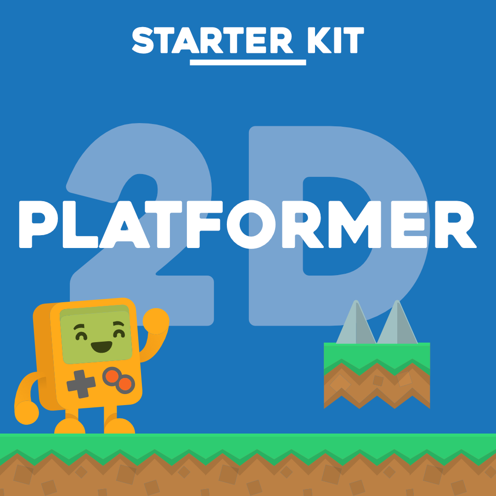

# 🎮 GODOT PS5

### The Godot Engine. Running natively on PlayStation 5 homebrew.

**A real Godot 4.7.2 runtime — not a video player, emulator or graphics mock-up.**

**Built by YAHBALLON** · Powered by the original Godot Engine

  
  
  
  

  
  
  

[**⬇️ DOWNLOAD PS5 GODOT**](https://github.com/Yahballon/PS5_Godot/releases/tag/v0.2.10) &nbsp;•&nbsp; [**🏓 PONG**](#-pong) &nbsp;•&nbsp; [**🏃 PLATFORMER**](#-2d-platformer) &nbsp;•&nbsp; [**🛠️ SOURCE**](#-source-code)

**GDScript · GLES3 · Physics2D · DualSense · Native AudioOut · External PCKs**

---

> [!IMPORTANT]
> **REAL HARDWARE — REAL 60 FPS.** The original v0.2.10 build was tested on a jailbroken PS5 running firmware 5.10. Both included Godot games maintained ~60 FPS after initial loading: **Pong** and **2D Platformer Starter Kit (Levels 1 and 2)**. This is an experimental community port, not an official Godot or Sony product. Not all PS5 firmwares or Godot features are verified.

## ✨ What works

| | Feature | Status |
|:--:|---|:--:|
| 🎮 | **Native PlayStation 5 homebrew title** — PPSA99847 | ✅ Hardware tested |
| 🧩 | **Real Godot 4.7.2 / GDScript execution** | ✅ Hardware tested |
| 🖥️ | **GLES3 / GL Compatibility renderer** | ✅ Hardware tested for 2D |
| 🕹️ | **DualSense input** — analog stick, D-pad, Cross / Circle | ✅ Hardware tested |
| ⚙️ | **2D physics** — CharacterBody2D and TileMap collision | ✅ Hardware tested |
| 🔊 | **Native PS5 AudioOut** — real game audio | ✅ Hardware tested |
| 📦 | **External Godot .pck games** | ✅ Hardware tested |
| ⚡ | **Buffered logging** — M26 performance breakthrough | ✅ Hardware tested |
| 🌐 | General Godot compatibility / 3D | 🚧 Not established |

## 🕹️ Sample games

<table>
  <tr>
    <td width="50%" align="center">
      <h3>🏓 PONG</h3>
      
<b>Godot GDScript • Canvas2D • 60 FPS</b>

      
Play against a bot in a fully native Godot 2D game. Included inside the PS5 homebrew by default — no separate game download required.

      
<a href="https://github.com/Yahballon/PS5_Godot/releases/download/v0.2.10/GodotPS5-Pong-v0.2.10.zip"><b>Download Pong ZIP</b></a>

      
<a href="godot-ps5/samples/pong-smoke/">View Pong project and GDScript</a>

    </td>
    <td width="50%" align="center">
      <h3>🏃 2D PLATFORMER</h3>
      

      
<b>2 levels • Real physics • Sound • 60 FPS</b>

      
The original MIT-licensed <i>2D Platformer Starter Kit</i>, adapted for PS5 controls, native audio and collision-preserving TileMap performance.

      
<a href="https://github.com/Yahballon/PS5_Godot/releases/download/v0.2.10/GodotPS5-M12d-Platformer-v0.2.10.zip"><b>Download Platformer ZIP</b></a>

      
<a href="samples/2d-platformer-ps5-source/">View editable game source + assets</a>

    </td>
  </tr>
</table>

<b>🎯 DualSense controls</b>

**Pong:** Left analog stick or D-pad up/down to move the paddle; **X** starts/serves, **Circle** resets the game, and **Options/Start** exits the sample, as implemented in the [real Pong script](godot-ps5/samples/pong-smoke/main.gd).

**Platformer:** Left analog stick / D-pad left and right to move; **X** to jump.

## 📥 Download & installation

**Latest public release:** [**Godot PS5 v0.2.10 — all files**](https://github.com/Yahballon/PS5_Godot/releases/tag/v0.2.10)

| Download | What you get |
|---|---|
| [**PPSA99847.zip**](https://github.com/Yahballon/PS5_Godot/releases/download/v0.2.10/PPSA99847.zip) | **Main PS5 homebrew installer** (22.7 MB). Comes with Pong bundled |
| [**GodotPS5-Pong-v0.2.10.zip**](https://github.com/Yahballon/PS5_Godot/releases/download/v0.2.10/GodotPS5-Pong-v0.2.10.zip) | Standalone external Pong pack and launcher configuration |
| [**GodotPS5-M12d-Platformer-v0.2.10.zip**](https://github.com/Yahballon/PS5_Godot/releases/download/v0.2.10/GodotPS5-M12d-Platformer-v0.2.10.zip) | Full external Platformer package with both levels |
| [pong.pck](https://github.com/Yahballon/PS5_Godot/releases/download/v0.2.10/pong.pck) | Raw Pong game package |
| [m12d-platformer-asset2201.pck](https://github.com/Yahballon/PS5_Godot/releases/download/v0.2.10/m12d-platformer-asset2201.pck) | Raw Platformer game package |
| [Source code](https://github.com/Yahballon/PS5_Godot/tree/v0.2.10) | Frozen port source, scripts, samples, and editable original Platformer assets |

### 1. Install the engine

Install **PPSA99847.zip** on a compatible jailbroken PS5 using a supported homebrew installer. Launch **Godot PS5** to play **Pong**, which is bundled by default.

> [!NOTE]
> This is a **PS5 homebrew** package, not an official retail PS5 PKG. The two downloadable samples are **Godot PCK data**, not separate PS5 title IDs.

### 2. Install another game

Download the Platformer ZIP, extract it and copy the **contents** of the <code>GodotPS5</code> folder to <code>/data/GodotPS5/</code> on the console.

~~~text
/data/GodotPS5/
├── games/
│   ├── m12d-platformer-asset2201.pck
│   └── pong.pck                 # optional external Pong
├── launch.txt                  # m12d-platformer-asset2201.pck
├── gles3-runtime.log
├── gles3-stdout.log
└── gles3-stderr.log
~~~

To launch the Platformer, put this exact line into <code>/data/GodotPS5/launch.txt</code>:

~~~text
m12d-platformer-asset2201.pck
~~~

Restart the homebrew. To go back to **bundled Pong**, simply **delete or rename <code>launch.txt</code>**, then restart the app. To choose any other compatible pack, place its filename under <code>games/</code> and reference that basename from <code>launch.txt</code>.

### 3. Keep the 60 FPS performance fix

> [!WARNING]
> **Don't switch the logs back to unbuffered mode.** The critical M26 improvement uses **128 KiB buffered stdout and stderr** to prevent heavy synchronous disk I/O from stalling the render thread. Leave <code>/data/GodotPS5/m26_log_mode.txt</code> **absent** (or remove an old file containing <code>unbuffered</code>). Keep <code>present_mode.txt</code> absent or set to <code>vsync</code>.

Buffered logs are written in batches. If the app is forcibly stopped, the newest stdout/stderr entries may not have reached the disk yet. The runtime log records which I/O mode was selected.

## 📊 Real PS5 performance

| Hardware test | Steady measured performance | Result |
|---|---|---|
| 🏓 **Pong** · TAR #46 | **9 × 300 frames / 5s** (45 s) | ✅ ~60 FPS, zero ≥80ms stalls after warmup |
| 🏃 **Platformer** · TAR #47 | **5 × ~300 frames / 5s** (25 s) | ✅ ~60 FPS, both levels loaded, no repeated stalls |

These are measurements from a **real PS5 on firmware 5.10**, with signed v0.2.10 and buffered logging active. There were short initial startup hitches. Longer sessions, more third-party games, save behavior across titles and 3D rendering need separate validation.

Read the detailed reports: [**Pong / M26**](godot-ps5/M26_PERFORMANCE.md) · [**Platformer / M27**](godot-ps5/M27_PLATFORMER_ACCEPTANCE.md) · [**All milestones**](godot-ps5/MILESTONES.md).

## 🧰 Source code

**This release includes real development source — not just binaries.**

| Folder | Contents |
|---|---|
| [<code>godot-ps5/engine/</code>](godot-ps5/engine/) | Native Godot PS5 platform support, DisplayServer and audio/input integration |
| [<code>godot-ps5/native/</code>](godot-ps5/native/) | PS5 launcher, OpenGL/EGL connection, M26 buffered logging |
| [<code>godot-ps5/scripts/</code>](godot-ps5/scripts/) | Engine source patches, PS5 build/staging tools |
| [<code>godot-ps5/gpu-probe/</code>](godot-ps5/gpu-probe/) | Community GPU/OpenGL bring-up and diagnostic tooling |
| [<code>godot-ps5/tests/</code>](godot-ps5/tests/) | Host regression and source integration tests |
| [<code>godot-ps5/samples/pong-smoke/</code>](godot-ps5/samples/pong-smoke/) | Fully editable Pong project, GDScript, packer |
| [<code>samples/2d-platformer-ps5-source/</code>](samples/2d-platformer-ps5-source/) | Full upstream Platformer scenes, scripts, graphics, audio and PS5 adapters |
| [<code>godot-ps5/samples/m12-platformer-2201/</code>](godot-ps5/samples/m12-platformer-2201/) | Reproducible Platformer preparation and PCK packaging scripts |
| [<code>.github/workflows/</code>](.github/workflows/) | Source-import, sample packaging and release automation |

<b>🔨 Build details and verified source revisions</b>

The original upstream **Godot 4.7.2 engine source is fetched when compiling** rather than embedded in this repository. The port requires a Linux toolchain including Clang 18, the community PS5 payload SDK, PS5 OpenGL support and the pinned native Godot build environment.

- Frozen, hardware-confirmed port: [tmp_lap M26 commit <code>39edf0e</code>](https://github.com/Yahballon/tmp_lap/commit/39edf0e42adbfa367cb08a22f3eed8c19030a769).
- Native cross-compile example: [M26 original PS5 build](https://github.com/Yahballon/tmp_lap/actions/runs/40131425332).
- Godot upstream: [<code>4.7.2-stable</code>](https://github.com/godotengine/godot/tree/4.7.2-stable).
- Original MIT Platformer: [AdilDevStuff / G2P Studios, commit <code>a48fc99</code>](https://github.com/AdilDevStuff/2D-Platformer-Starter-Kit/tree/a48fc994cbcb168be472df84f2e13b55d2a2792f).
- [Build notes](godot-ps5/ENGINE_PORTING.md) · [graphics notes](godot-ps5/GRAPHICS_BRINGUP.md) · [source provenance](SOURCE_PROVENANCE.md).

The [publishing workflow](.github/workflows/publish-godot-ps5.yml) recreates the two sample PCKs and publishes the **unchanged, hardware-tested PS5 installer** after verifying its checksum. It does **not** silently rebuild a different engine.

**Installer SHA-256:**

~~~text
e5d9e2107424cc949bdaae59a6afd7e6c66be5bc15ebeab5afd564e714ffcf2e  PPSA99847.zip
~~~

## 🗺️ Project status & roadmap

- [x] Genuine Godot 4.7.2 engine executing on PS5
- [x] GLES3 / Godot 2D renderer and live GDScript
- [x] DualSense input, 2D collisions, native audio
- [x] Loading external <code>.pck</code> projects
- [x] **Sustained 60 FPS in Pong and the 2D Platformer**
- [x] Open-source GitHub release with both playable game packages
- [ ] Longer multi-game and multi-hour endurance testing
- [ ] Broader Godot 4.x project compatibility
- [ ] More 2D examples and improved diagnostic UX
- [ ] Investigate other rendering workloads and possible 3D support

## ❤️ Credits, licenses & acknowledgements

- **PS5 port / integration:** [YAHBALLON](https://github.com/Yahballon).
- **Engine:** [Godot Engine](https://godotengine.org/), © Godot contributors, MIT license.
- **Platformer:** [2D Platformer Starter Kit](https://github.com/AdilDevStuff/2D-Platformer-Starter-Kit), © **G2P Studios / AdilDevStuff**, MIT licensed. Includes assets credited to **Kenney.nl** and sounds made with **Gdfxr**. Upstream license and original game source are included.
- **Homebrew stack:** PS5 payload SDK, the community OpenGL/AGC project and PS5-DevBridge contributors.

The root project uses a **GPL-3.0 license**, while the Godot platform overlay and the MIT-licensed third-party game retain their own licenses and file-level notices. See [LICENSE](LICENSE), [godot-ps5/LICENSE](godot-ps5/LICENSE) and [original Platformer LICENSE](samples/2d-platformer-ps5-source/LICENSE). No Sony firmware or proprietary Sony SDK binaries are part of the published source.

---

### Built with ❤️ for the PS5 homebrew community.

**GODOT PS5 · by YAHBALLON**

**[⬇️ Get v0.2.10](https://github.com/Yahballon/PS5_Godot/releases/tag/v0.2.10) · [⭐ Star on GitHub](https://github.com/Yahballon/PS5_Godot) · [📜 Milestones](godot-ps5/MILESTONES.md)**

Unofficial community port · Firmware 5.10 hardware-verified · 2D games at ~60 FPS after warmup

